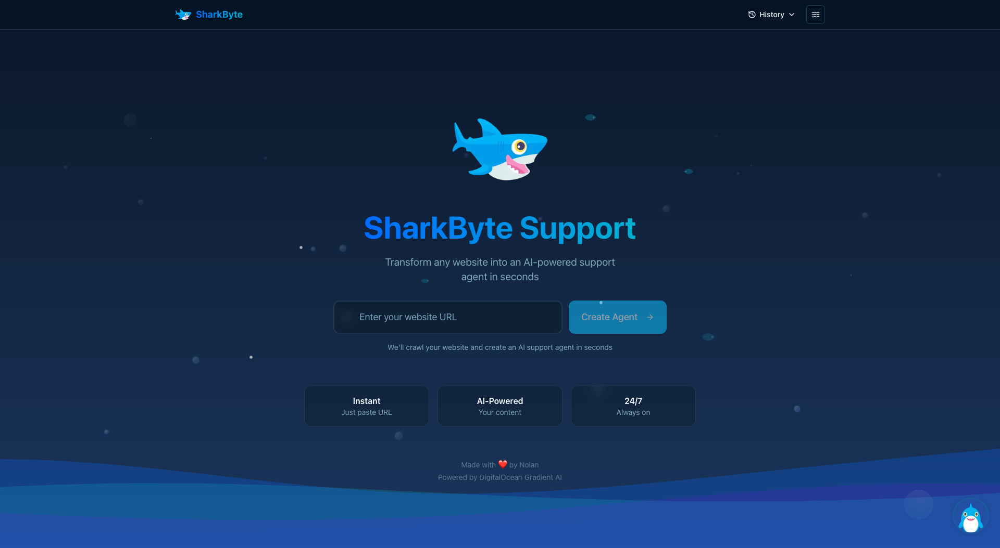
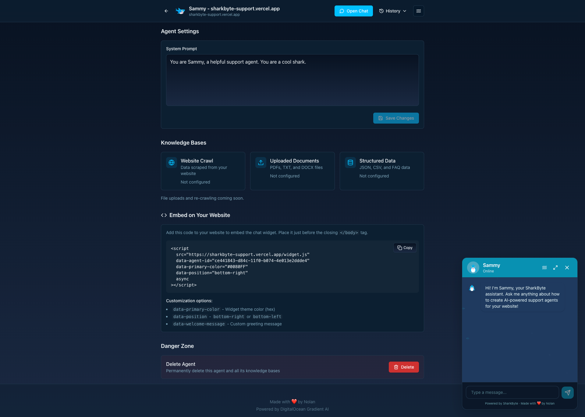
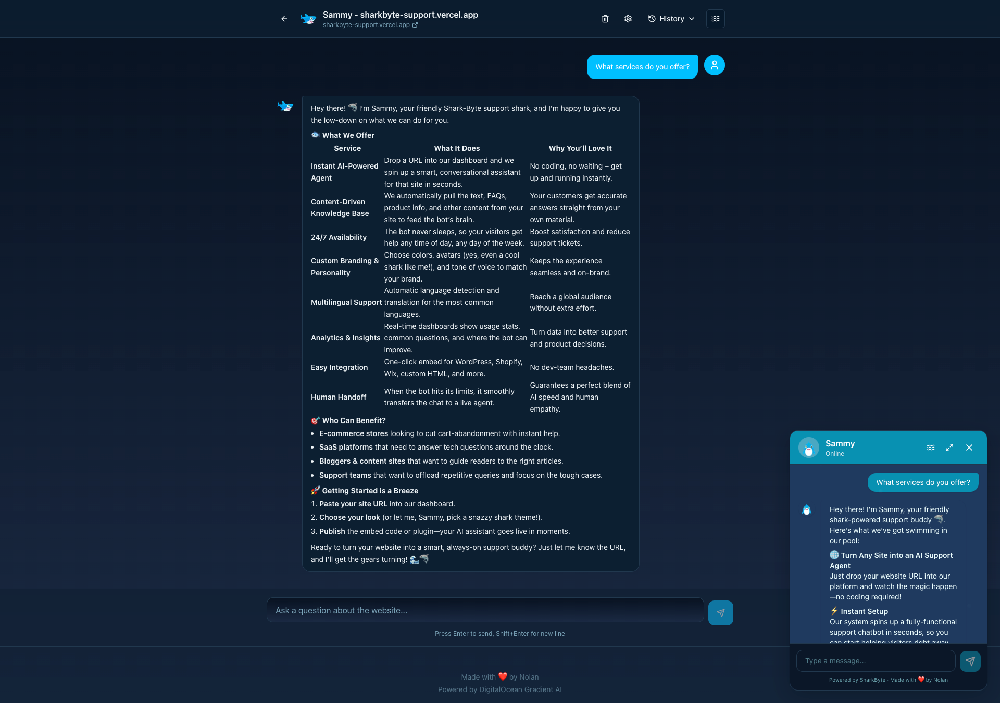
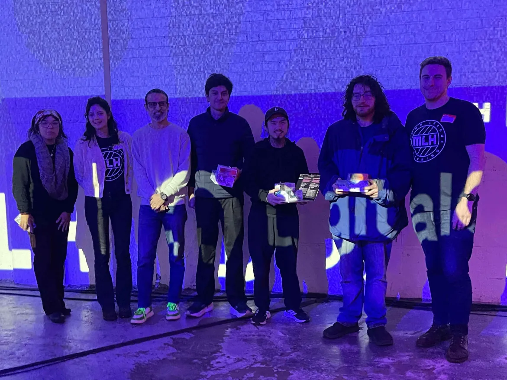
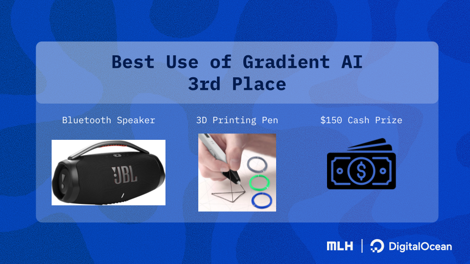

<h1 align="center">SharkByte Support</h1>

<p align="center">
  
</p>

<p align="center">
  <a href="https://devpost.com/software/sharkbyte-support">
    
  </a>
</p>

<p align="center">
  <strong>Smart support in every byte.</strong><br/>
  Transform any website into an AI-powered customer support agent in seconds.
</p>

---

## What is SharkByte?

SharkByte instantly creates an AI chatbot that can answer questions about any website. Just paste a URL, and we handle the rest - no FAQ writing, no training, no complex setup.

**How it works:**
1. Enter a website URL
2. We crawl and analyze the content
3. Your AI support agent is ready to chat

---

## Features

- **Instant Setup** - No configuration required
- **Website-Aware** - Answers based on actual site content
- **Streaming Responses** - Real-time chat experience
- **Theme Options** - Light, Dark, and Ocean modes
- **Mobile Friendly** - Works on all devices

---

## Screenshots

<p align="center">
  
</p>
<p align="center"><em>Homepage - Enter any URL to create an AI support agent</em></p>

<p align="center">
  
</p>
<p align="center"><em>Agent configuration with embed code</em></p>

<p align="center">
  
</p>
<p align="center"><em>Chat with Sammy about any site</em></p>

---

## Tech Stack

- **Framework**: Next.js 16 (App Router + Turbopack), React 19, Tailwind CSS v4 + shadcn/ui
- **Database**: Postgres with pgvector (Neon)
- **Embeddings**: Google Gemini (`gemini-embedding-001`, 768 dimensions, free tier); NVIDIA Build as a fallback
- **Chat**: a free LLM chain (Cerebras → OpenRouter → NVIDIA) streamed with AI SDK 7
- **Crawling**: built-in sitemap/HTML crawler, Firecrawl for JavaScript-rendered pages (optional)
- **Analytics**: PostHog (optional)
- **Hosting**: Vercel

**Cost: $0 on free tiers.** Built-in rails (pages per agent, crawls and chat tokens per day,
total storage) keep a public demo inside the free quotas; see [DEPLOYMENT.md](DEPLOYMENT.md).

Originally built on DigitalOcean Gradient AI for the MLH × DigitalOcean hackathon.

---

## Getting Started

### Prerequisites

- [Bun](https://bun.sh)
- A Postgres database with the `vector` extension (a free [Neon](https://neon.tech) project works)
- A [Gemini API](https://aistudio.google.com/apikey) key (free tier) for embeddings
- One free LLM key: [Cerebras](https://cloud.cerebras.ai/), [OpenRouter](https://openrouter.ai/) or [NVIDIA Build](https://build.nvidia.com)

### Installation

```bash
# Clone the repository
git clone https://github.com/iamnolanhu/sharkbyte-support.git
cd sharkbyte-support

# Install dependencies
bun install

# Set up environment variables
cp .env.example .env.local
# Edit .env.local: DATABASE_URL, GEMINI_API_KEY and one LLM key at minimum

# Run development server
bun run dev
```

The database schema creates itself on the first request.

### Environment Variables

`.env.example` lists every variable with a one-line comment. The short version:

```env
# Required
DATABASE_URL=postgres://...        # Postgres with pgvector
GEMINI_API_KEY=                    # Embeddings (Gemini API free tier)
# ...and at least one LLM key:
CEREBRAS_API_KEY=                  # Fastest free LLM, first in the chain
OPENROUTER_API_KEY=                # Free OpenRouter models
NVIDIA_API_KEY=                    # Last LLM in the chain

# Optional
FIRECRAWL_API_KEY=                 # JavaScript-rendered pages (capped free key)
CRON_SECRET=                       # Protects the daily storage sweep
NEXT_PUBLIC_POSTHOG_KEY=           # Browser analytics (the only public key)
POSTHOG_API_KEY=                   # Server analytics
```

---

## Usage

1. Open [http://localhost:3000](http://localhost:3000)
2. Enter a website URL
3. Wait for the agent to be created
4. Start chatting!

---

## Embed on Your Website

Add the chat widget to any website with a single script tag:

```html
<script
  src="https://sharkbyte-support.vercel.app/widget.js"
  data-agent-id="your-agent-id"
  data-primary-color="#0080FF"
  data-position="bottom-right"
  async
></script>
```

**Options:**
- `data-primary-color` - Widget accent color (hex)
- `data-position` - `bottom-right` or `bottom-left`
- `data-welcome-message` - Custom greeting message

Try it on a plain page: /embed-demo.html

---

## Deployment

Deploy to Vercel with one click:

[](https://vercel.com/new/clone?repository-url=https://github.com/iamnolanhu/sharkbyte-support)

Then:

1. Add **Neon** from the Vercel Marketplace (Storage tab); it sets `DATABASE_URL` for you.
2. Add `GEMINI_API_KEY` and at least one LLM key (`CEREBRAS_API_KEY`, `OPENROUTER_API_KEY` or `NVIDIA_API_KEY`).
3. Optionally add `CRON_SECRET`, `FIRECRAWL_API_KEY` and the PostHog keys.
4. Redeploy. The schema creates itself on the first request.

**See [DEPLOYMENT.md](DEPLOYMENT.md) for the complete deployment guide**: every variable, the free-tier rails and their knobs, the daily sweep, and troubleshooting.

---

## Project Structure

```
sharkbyte-support/
├── public/
│   ├── images/       # Screenshots & hackathon photos
│   ├── sammy/        # Sammy mascot assets
│   └── widget.js     # Embeddable chat widget
├── src/
│   ├── app/          # Next.js pages & API routes
│   ├── components/   # React components
│   ├── lib/          # Database, crawler, embeddings, LLM chain, rails, config
│   ├── styles/       # Theme system
│   └── types/        # TypeScript interfaces
└── [config files]    # package.json, tsconfig, etc.
```

---

## Team

<p align="center">
  
  &nbsp;&nbsp;&nbsp;
  
</p>

<p align="center"><strong>The Sharks</strong> 🦈 - <strong>3rd Place</strong> at MLH x DigitalOcean Hackathon 2025</p>

<p align="center">
  <a href="https://devpost.com/software/sharkbyte-support">View on Devpost</a> | <a href="https://sharkbyte-support.vercel.app/">Live Demo</a>
</p>

---

## Built With

- [Next.js](https://nextjs.org/)
- [Tailwind CSS](https://tailwindcss.com/)
- [shadcn/ui](https://ui.shadcn.com/)
- [Framer Motion](https://www.framer.com/motion/)
- [Vercel AI SDK](https://ai-sdk.dev/)
- [Neon](https://neon.tech/) + [pgvector](https://github.com/pgvector/pgvector)
- [NVIDIA Build](https://build.nvidia.com/), [Cerebras](https://cloud.cerebras.ai/) and [OpenRouter](https://openrouter.ai/)
- [PostHog](https://posthog.com/)

---

## License

**Dual License** - Free for non-commercial and open source use. Commercial use requires a paid license. See [LICENSE](LICENSE) for details.
